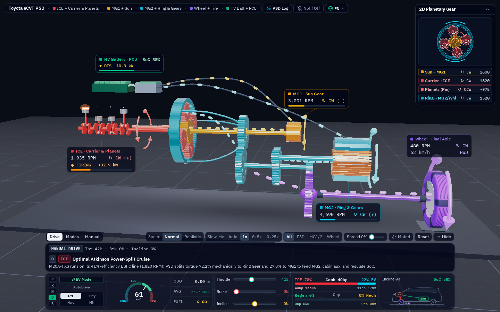

<div align="center">
  <br />
  
  <h1>Toyota eCVT Power Split Device 3D Visualization</h1>
  <p>
    <strong>5th-Generation Toyota Hybrid System (THS V) · Interactive Physics &amp; Driving Simulator</strong>
  </p>
  <p>
    <a href="https://toyota-ecvt.vercel.app/" target="_blank" rel="noopener noreferrer">
      <strong>Live App → https://toyota-ecvt.vercel.app/</strong>
    </a>
  </p>
  <p>
    Calibrated to a <strong>Toyota Kijang Innova Zenix Hybrid (AG10)</strong> with <strong>4 adult passengers (2,020 kg laden mass)</strong>.<br />
    <sub>Three.js WebGL &nbsp;·&nbsp; React &amp; TypeScript &nbsp;·&nbsp; Exact Willis Kinematics &nbsp;·&nbsp; Multi-Language HUD</sub>
  </p>
  <br />
  <a href="https://toyota-ecvt.vercel.app/" target="_blank" rel="noopener noreferrer">
    
  </a>
</div>

---

## Reference Powertrain & Vehicle Specifications

| Parameter | Audited Model Value | Real-World Counterpart |
| :--- | :--- | :--- |
| **Vehicle / Load** | `1,730 kg` kerb + `4 × 72.5 kg` = **`2,020 kg`** | Toyota Innova Zenix Hybrid (AG10) + 4 adults |
| **Aero & Tires** | `Cd 0.32 × 2.75 m²` (`CdA = 0.88 m²`), `Crr = 0.0110`, `2.14 m` circ. | MPV profile on `215/60R17` tires |
| **ICE (`M20A-FXS`)** | `2.0L` Atkinson I4 · `112 kW (150 hp)` @ `6,000 RPM` · `188 Nm` peak | Mechanical 1-way CW crank (`0 .. 6,000 RPM`), peak `41%` thermal eff. |
| **MG2 (`1VM`)** | `83 kW (111 hp)` · `206 Nm` · `17,000 RPM` max | Permanent-magnet traction motor coupled to Ring & Countershaft |
| **MG1 (`1VM-G`)** | `±10,500 RPM` bi-directional starter / generator | Coupled to Sun gear (`30T`) |
| **HV Battery** | `201.6 V · 6.5 Ah` (`1.31 kWh / 4,716 kJ` NiMH) | `~26.5 kW` peak boost · `~32 kW` peak regen · `<40% -> 48%` hysteresis |
| **Combined Output** | **`137 kW (186 PS / 184 hp)`** · `~123 kW` net at drive axle | `0–100 km/h`: **~11.1 s** (4 adults) · Top speed: **~172–175 km/h** |
| **READY Aux Load** | **`0.90 kW`** continuous (`P / R / N / D / B`) | Inverter A/C (coldest temp, lowest fan) + infotainment & 12V DC-DC |

### Planetary Gearset Ratios (Willis Kinematics)
- **Sun Gear (MG1):** `Z_S = 30` teeth
- **Planet Gears (4× on Carrier):** `Z_P = 24` teeth each
- **Ring Gear (MG2 / Counter Drive):** `Z_R = 78` teeth
- **Willis Identity:** `30 · ω_MG1 + 78 · ω_Ring = 108 · ω_ICE`
- **Torque Split:** `72.2%` Mechanical (`78/108`) to Ring/Wheels · `27.8%` (`30/108`) to Sun/MG1
- **Transaxle Reduction:** Countershaft (`40:44`), MG2 Pinion (`13:40`), Final Diff (`18:52`) → `Ring-to-Wheel = 3.1778:1`, `MG2-to-Wheel = 9.7778:1`

---

## Features & Controls

1. **Drive Tab (Live Driving Simulator)**
   - **Transmission (`P / R / N / D / B`):** Mechanical Park pawl (with active stationary inverter charging `<40%` SoC), gearless AC phase-reversed EV Reverse, Neutral inverter gate shutdown (still drains `0.9 kW` READY aux load), Drive, and B-range downhill compression braking.
   - **AutoDrive Modes (`Off / City / Hwy / Mtn`):** 35+ randomized real-world traffic & terrain events (traffic lights, jams, crosswalks, flyovers, on-ramps, convoys, overtakes, toll plazas, rain caution, steep mountain switchbacks & descents) with multi-stage transitional phases when switching modes.
   - **Live Telemetry:** Toyota HSI Power Meter (`CHG / ECO EV / ECO HYBRID / PWR`), Digital Speedometer, Odometer (`km`), Trip Fuel (`L`), Avg Consumption (`km/L`), Propulsion & Braking Split Bars, and Innova Zenix 3-node energy flow silhouette.
   - **Keyboard Shortcuts:** `W` / `↑` Throttle · `S` / `↓` Brake · `Space` Release pedals · `H` Collapse/Expand Dock.

2. **Modes Tab (10 Representative THS-5 Regimes)**
   - Instant inspection of `Ready Stop`, `Park Charge`, `EV Drive`, `ICE Start`, `Normal Split`, `Power Boost`, `Overdrive`, `Regen Brake`, `B-Mode Brake`, and `Reverse EV`.

3. **Manual Tab (Kinematic Sandbox)**
   - Independent sliders for **ICE**, **MG1**, and **MG2/Ring** (`+ km/h` readout) solving the selected target shaft via the Willis equation.
   - Enforces real mechanical constraints: ICE is CW-only (`0 .. 6,000 RPM`, CCW disabled), while MG1 and MG2/Ring support bi-directional rotation.

4. **Auto Slo-Mo & PSD Transition Event Log**
   - **Auto Slo-Mo:** Automatically slows visualization to `0.5x` just before and after any hybrid mode shift, power flow reversal, or shaft direction change.
   - **PSD Log (`100`-entry rolling history) & Notifications:** Explains *why* every hybrid transition, flow reversal, or rotational flip occurred.

---

## Clean Modular Architecture

```
src/
├── types/                  # Domain enums, state interfaces, component color palette
│   └── hybrid.ts
├── drivetrain/             # Pure THS-5 & Innova Zenix physics engine (0 React/DOM deps)
│   ├── vehicleSpecs.ts     # AG10 mass, aero/tire grip, M20A-FXS torque & BSFC curves
│   ├── willisKinematics.ts # Exact Willis planetary equations & driveline speed ratios
│   ├── thermodynamicsAndSplits.ts # Atkinson fuel rate, inverter losses, prop/brake splits
│   ├── operationModes.ts   # 10 audited preset modes with balanced power flows
│   ├── manualKinematicsSolver.ts  # Constrained 3-shaft manual Willis solver
│   ├── drivingPhysics.ts   # Continuous P/R/N/D/B longitudinal dynamics & hybrid ECU
│   ├── psdEventLogger.ts   # Transition detector & predictive Auto Slo-Mo trigger
│   └── index.ts
├── autodrive/              # Pure AutoDrive traffic & terrain AI (0 React/DOM deps)
│   ├── idleStatus.ts       # Shared OFF status constant
│   ├── scenarios.ts        # 35+ City/Hwy/Mtn situation specs, transitions & status copy
│   ├── autoDriveController.ts # Mode transition queues, terrain grade & pedal PID/FF
│   └── index.ts
├── engine/                 # Application orchestration ("Backend" Session Layer)
│   ├── hybridSimulationSession.ts # Framework-agnostic tick, log ring buffer & overrides
│   ├── useHybridSimulation.ts     # React hook binding session, audio & keyboard inputs
│   └── index.ts
├── three/                  # Interactive Three.js 3D powertrain & energy-stream scene
│   ├── buildPowertrainScene.ts
│   ├── gearGeometry.ts
│   └── proceduralTextures.ts
├── audio/                  # Web Audio procedural synthesizer (AVAS, MG1/2 whine, ICE, tire)
│   └── hybridAudioEngine.ts
├── i18n/                   # Modular UI localization (strictly defaults to English)
│   ├── locales/            # Isolated language dictionaries (en, id, ja, zh, es)
│   ├── I18nContext.tsx
│   ├── index.ts
│   └── types.ts
├── components/             # Presentational React UI & HUD overlays
│   ├── dock/               # Subcomponents for BottomControlDock
│   ├── BottomControlDock.tsx
│   ├── CarEnergyFlowPreview.tsx
│   ├── HybridPowerMeter.tsx
│   ├── Planetary2DInsert.tsx
│   ├── PowertrainViewport.tsx
│   └── PsdLogModal.tsx
└── App.tsx                 # Top-level viewport + dock + log modal composition
```

---

## Development & Verification Commands

```bash
# Install dependencies
npm install

# Run development server on port 3000
npm run dev

# Run full regression test suite & Toyota Innova Zenix Hybrid audit
npm test

# Type-check with TypeScript (zero errors required)
npm run lint

# Build production bundle
npm run build
```
